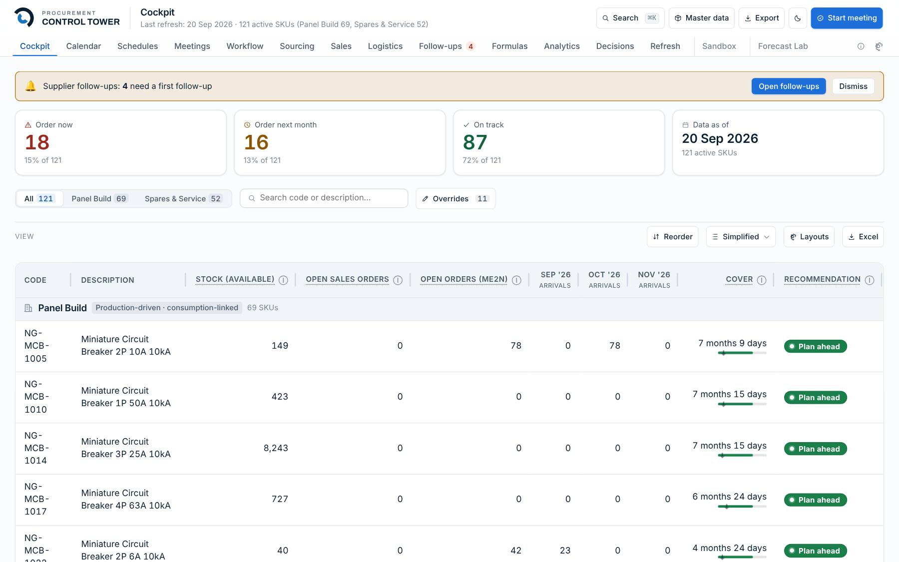
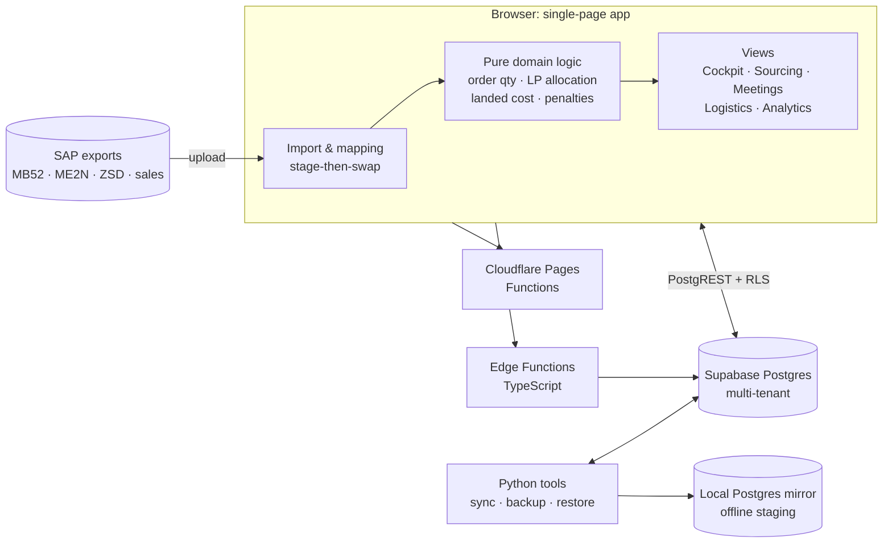
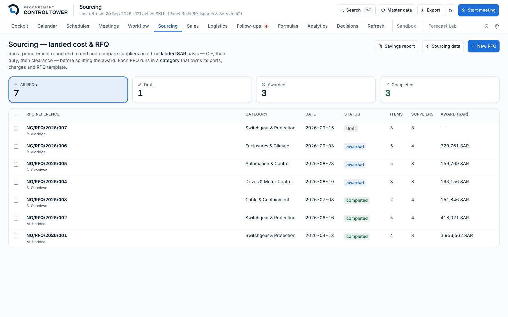
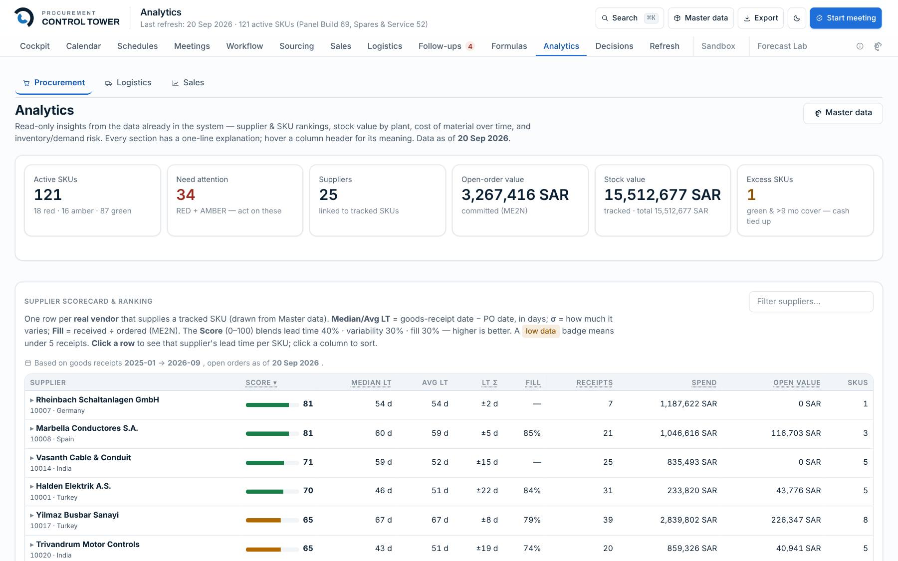
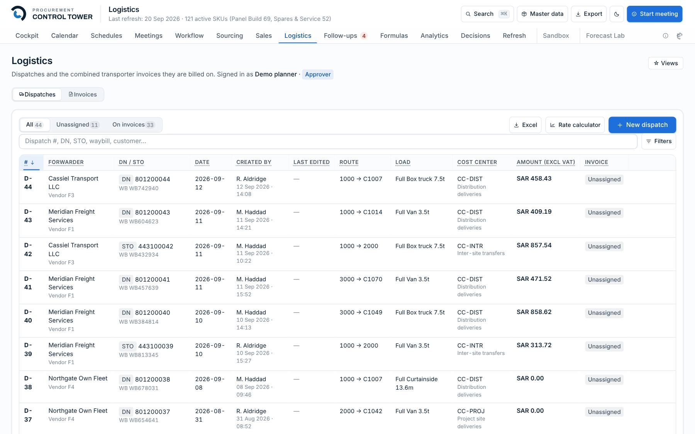
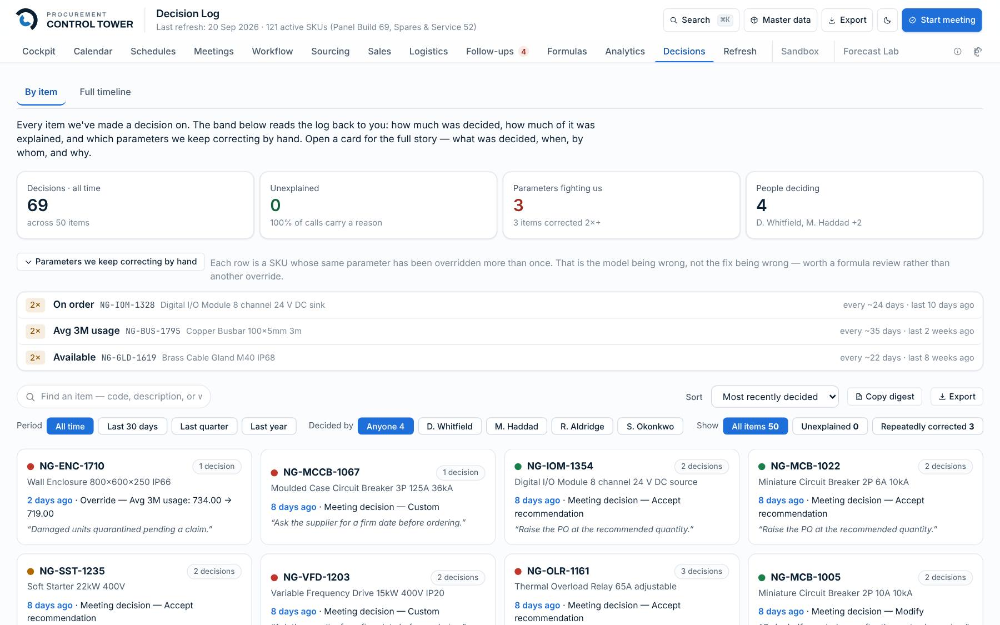
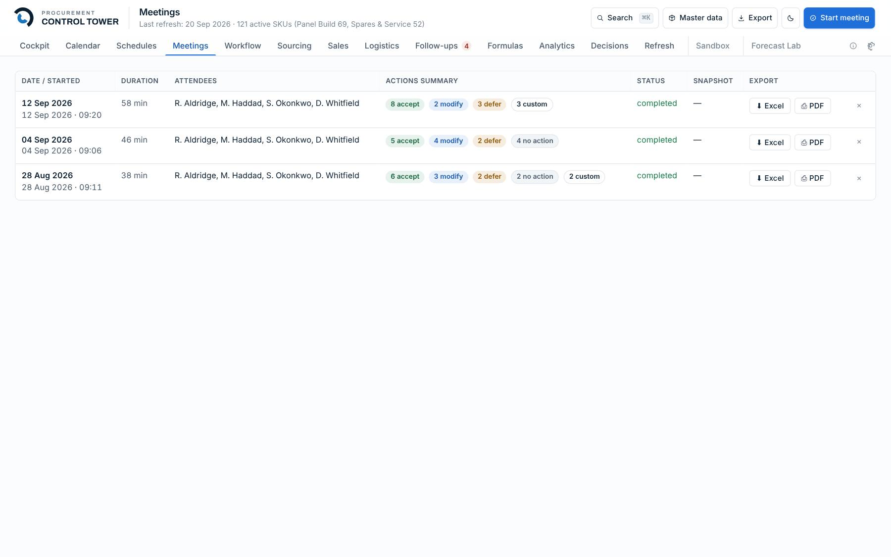
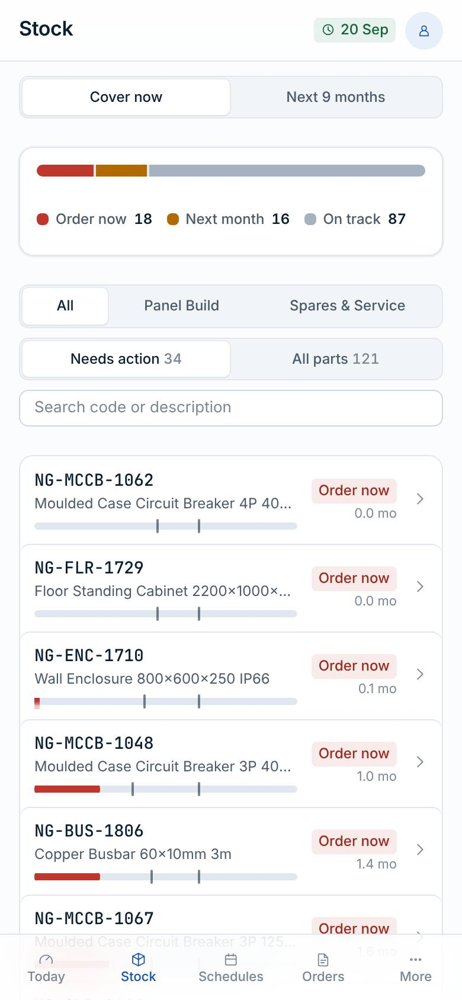

# Procurement Control Tower

**A procurement and demand-planning platform I designed and built for an industrial manufacturer, now offered as [Spendeka](https://spendeka.com).**
It takes raw SAP exports and turns them into one place to decide what to order, from whom, when, and at what landed cost, then tracks every commitment through to delivery.

[**Live site: spendeka.com**](https://spendeka.com) · [**Interactive demo**](https://spendeka.com/demo.html) · [LinkedIn](https://www.linkedin.com/in/u-shahid77/)

> Screenshots use a fictional demo company (*Northgate Control Systems*) generated for this purpose. No customer data is shown.
> The production source code is private because it runs a live business. This repository explains what the system does and how it was built.

---

## Contents
- [The problem](#the-problem)
- [What it does](#what-it-does)
- [Tech stack](#tech-stack)
- [Architecture](#architecture)
- [Engineering highlights](#engineering-highlights)
- [How I worked](#how-i-worked)
- [Screens](#screens)
- [About me](#about-me)

---

## The problem

I run procurement for a scaffolding manufacturer: about **USD 5M a month** across a dozen international suppliers in India, the UAE, China and Taiwan, plus local sourcing in Saudi Arabia.

SAP holds the transactions, but the decisions lived in spreadsheets:
- *Which of 100+ SKUs need ordering this week, and how much?* Stock, open sales orders, open POs and lead times were in four different SAP reports.
- *Which supplier should get the order?* Quotes come in different currencies and Incoterms. The cheapest unit price is often not the cheapest **landed** price once freight, duty and clearance are added.
- *Is the supplier on time, and what do they owe us if not?* Liquidated-damages penalties were calculated by hand.
- *Why did we award it that way?* The reasoning behind a decision was lost once the meeting ended.

I wanted one tool that works **alongside** SAP (no changes to the ERP) and turns its exports into a demand-to-delivery control tower.

## What it does

| Area | What the user gets |
|---|---|
| **Cockpit** | Every active SKU with available stock, open sales orders, open POs, arrivals by month, months of cover, and an *order now / order next month / on track* recommendation |
| **Demand planning** | Order-quantity logic that lands stock between Min and Max, plus a forecast lab and safety stock tiered by service level |
| **Sourcing & RFQs** | RFQ rounds by category, quotation comparison on a landed SAR basis (CIF → duty → clearance), split awards, savings report, award PDF |
| **Supplier capacity allocation** | A time-phased linear program that splits demand across suppliers by capacity, lead time and cost |
| **Meetings & decisions** | Run the weekly procurement meeting in the app. Decisions, award reasons and action points are recorded in an audit trail. |
| **Logistics** | Inbound and outbound dispatches, a freight cost model fitted from real trips, KSA-specific validation |
| **Delivery performance** | Supplier schedules, follow-ups, OTIF, and liquidated-damages penalty statements |
| **Analytics** | Spend, supplier price comparisons, freight cost per km, and the quotation pipeline |
| **Mobile** | A phone layout for checking cover and schedules on the shop floor |

## Tech stack

| Layer | Technology |
|---|---|
| Front end | **JavaScript** (ES modules, no framework), **HTML**, **CSS** with a token-based design system I wrote |
| Bundling | esbuild, plus a small shell build that assembles the single-page app |
| Database | **PostgreSQL** on **Supabase**, with row-level security on every table and multi-tenant isolation |
| Server logic | **SQL** (RPCs, policies, 90+ versioned migrations) and **TypeScript** Supabase Edge Functions (Deno) |
| Hosting | **Cloudflare Pages** plus Pages Functions (e.g. a road-distance API for freight) |
| Data pipeline | **Python**: SAP export import, sync, backup and restore, tenant provisioning |
| Testing | `node --test` (100+ unit test files, about 1,100 tests), golden-file tests for money calculations, **Playwright** end-to-end |
| CI/CD | **GitHub Actions** quality gate. Production deploys only from `main` after CI passes, and the live `/version.json` is checked after upload. |
| Tooling | Bash automation, Node scripts for generated docs, screenshots and the demo dataset |

**Approximate size of the codebase (excluding generated files):** about 97k lines of JavaScript, 14k CSS, 13k SQL, 11k Python, 7k HTML, 3k shell.

## Architecture

The same app runs in **three modes**, chosen automatically at startup:
1. **File mode:** local JSON files, single user, no setup. This is how it started.
2. **Local staging:** a local Postgres mirror of production behind PostgREST, used to test risky changes offline.
3. **Cloud:** Cloudflare Pages plus Supabase with real authentication, row-level security and server-checked permissions.

More detail: [docs/architecture.md](docs/architecture.md) · [docs/decisions.md](docs/decisions.md)

## Engineering highlights

- **I wrote my own LP solver.** Supplier allocation is a time-phased linear program solved by a deterministic simplex method with **lexicographic objectives**: cover demand first, then respect capacity, then minimise cost, with no tuning weights. Bland's rule is used to prevent cycling, so the same input always gives the same award.
- **Freight model built for messy data.** The freight cost per km is fitted with a **Theil–Sen** robust regression, so a single odd invoice cannot skew the rate the way ordinary least squares would. The app shows both fits side by side.
- **Money is tested against golden files.** Penalty statements, landed cost and freight maths were moved out of a 46,000-line file into pure modules and pinned with golden tests.
- **Migrated from JSON to Postgres one table at a time.** The app started as a JSON document on disk. Each domain moved to relational tables in a separate, reversible phase (40+ phases). Each JavaScript mapper has a Python twin, and fixture diffs keep the two identical.
- **Multi-tenant and secure by default.** Row-level security on every table, server-checked permissions, Edge Functions for admin actions and tenant switching, idle-session sign-out, and a sign-in activity log.
- **Releases are gated.** Production deploys only a commit on `main` whose CI passed, then confirms the live site reports that commit. A documentation guard fails CI if code changes without its documentation.
- **Design system.** Semantic colour tokens, concentric radii, spring motion, light and dark themes, and every view built to handle five states (idle, loading, empty, error, success).

## How I worked

I'm a procurement engineer, not a career software developer, and this project is where the two meet. I designed the product, the procurement logic and the data model from what I needed every day, then built it **with an AI pair-programmer (Claude Code)**, reviewing each change and keeping it under CI and tests. Practices I adopted along the way:

- Decision records for anything costly to reverse (authentication, hosting, policies)
- A changelog and a documentation register kept in step with the code
- A fictional demo company and frozen-clock screenshots, so the product can be shown without exposing real data
- Backup and restore runbooks, rehearsed against a local mirror

## Screens

| | |
|---|---|
|  **Sourcing:** RFQs compared on landed cost |  **Analytics:** spend, supplier price and freight |
|  **Logistics:** dispatches and freight model |  **Decisions:** audit trail of awards |
|  **Meetings:** run the weekly review in the app |  **Mobile:** cockpit on a phone |

## About me

**M. Usama Shahid**: Procurement & Demand Planning Engineer, Al Khobar, Saudi Arabia.
M.E. Structural Engineering (KFUPM) · B.E. Civil Engineering (NUST).
SAP MM & Ariba · SQL · Power BI · demand planning · strategic sourcing.

[spendeka.com](https://spendeka.com) · [LinkedIn](https://www.linkedin.com/in/u-shahid77/) · mshahid.nust@gmail.com

---
© M. Usama Shahid. This repository contains documentation and screenshots only. All rights reserved.
