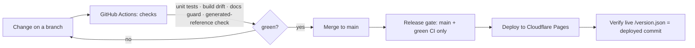

# Architecture

[← back to overview](../README.md)

## Shape of the system

The app is a client-side single-page application with no front-end framework. Source partials and about 60 ES modules are bundled into one page. The browser does the planning maths, and Postgres stores the data and enforces who can see it.

```
SAP exports ──► import & mapping ──► domain logic ──► views
                     │                    │
                     ▼                    ▼
               Postgres (Supabase) ◄── repos (rows ⇄ objects)
                     ▲
          Python tools (sync, backup, restore, provisioning)
```

## Module kinds

The codebase follows a strict one-way dependency rule: the app shell imports modules, and modules never import the shell or read global state.

| Kind | Responsibility | Example concerns |
|---|---|---|
| **Repos** | Convert between in-app objects and Postgres rows, losslessly | One per business domain; saves write only the rows that changed |
| **Pure domain logic** | All the maths and business rules, with no I/O | Order quantity, LP allocation, landed cost, penalties, freight model, schedule status |
| **Views** | One part of a screen per file: props in, HTML out | Each declares a `Props / State / Renders / Emits` contract and handles five UI states |
| **Mobile views** | Phone layouts of the key screens | Cockpit, schedules, follow-ups |

Keeping the business logic pure is what makes it testable. The penalty and freight calculations used to sit inside one very large file with no tests. Pulling them out into pure modules allowed golden-file tests.

## Data model

- PostgreSQL on Supabase, with schema managed as **90+ versioned migrations**
- **Row-level security** on business tables. Every row belongs to a tenant, and the server resolves permissions through an RPC, so the browser is never trusted to decide access.
- Bulk SAP imports use a **stage-then-swap** pattern: rows load into staging, get validated, and replace the live set in one step, so a bad file never leaves half-imported data.
- Reference numbers (RFQ, PO, quotation) come from server-side counters to avoid collisions between users.

## Three runtime modes

| Mode | Storage | Purpose |
|---|---|---|
| File | JSON on disk via a tiny Python server | Zero-setup, single user. This is where the project began. |
| Local staging | Local Postgres mirror behind PostgREST | Rehearse migrations and risky changes offline, with production data shape |
| Cloud | Supabase + Cloudflare Pages | Multi-user production with auth, RLS and audit |

## Delivery pipeline



## Operations

- Daily backup from Supabase into a local Postgres mirror, plus a documented restore path for disaster recovery
- Edge Functions (TypeScript) for privileged actions: user administration and tenant switching
- Idle-session warning and sign-out, plus a sign-in activity log
- A fictional demo dataset and frozen-clock screenshot pipeline, so marketing and documentation never use real data
